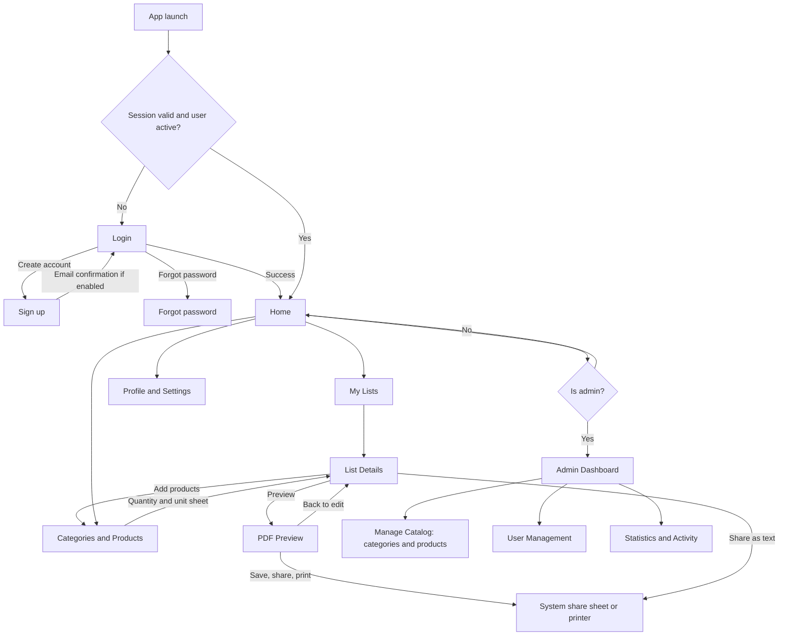
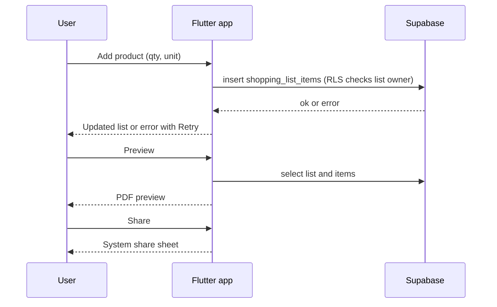
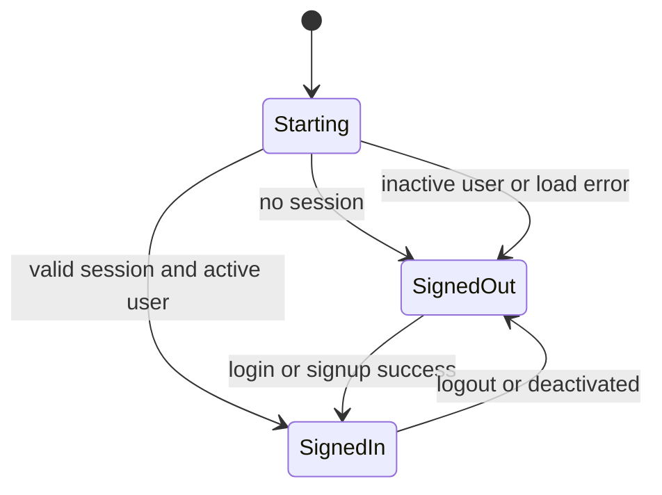
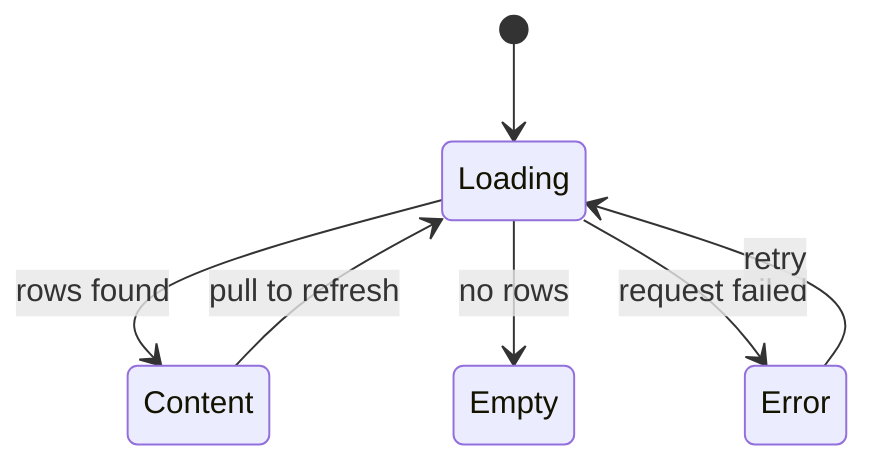
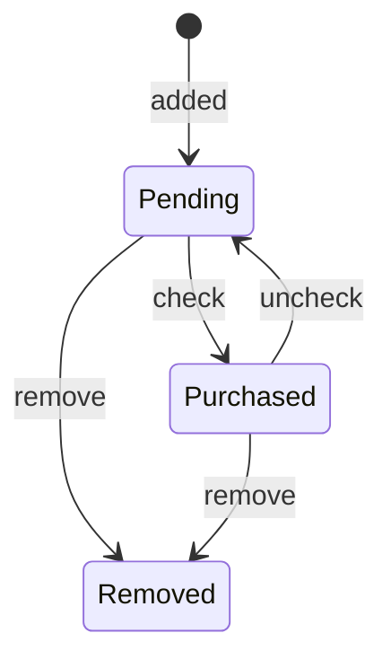

# Application Flow and State Machine: SaudaList

Version 2.0

## 1. Journey map

## 2. Routes

| Route | Screen | Who |
|---|---|---|
| `/login` | Login | Public |
| `/signup` | Sign up | Public |
| `/forgot-password` | Forgot password | Public |
| `/home` | Home | Signed-in |
| `/categories` | Categories | Signed-in |
| `/products` | Products (search and filter) | Signed-in |
| `/my-lists` | My Lists | Signed-in |
| `/list-details` | List details | Signed-in (owner) |
| `/pdf-preview` | PDF preview and export | Signed-in (owner) |
| `/profile` | Profile and settings | Signed-in |
| `/admin` | Admin dashboard | Admin |
| `/admin/catalog` | Manage categories and products | Admin |
| `/admin/users` | User management | Admin |
| `/admin/analytics` | Statistics (counts) | Admin |

Route guards: unauthenticated users go to `/login`. Non-admin users cannot open `/admin...` screens. These guards are for usability only. The database enforces the real permission.

## 3. Detailed flows

### 3.1 Sign up
1. User enters full name, email, password, confirm password.
2. App calls Supabase `signUp` with `full_name` in metadata.
3. A database trigger creates the `profiles` and `user_roles` (customer) rows.
4. If email confirmation is on, the app asks the user to confirm and sign in. If off, the app loads the profile and goes to Home.

### 3.2 Sign in and session
1. App start: initialize Supabase, check the stored session.
2. If a session exists, load the profile, role, and active flag. If the user is inactive or the session is invalid, sign out and go to Login.
3. Sign in: validate fields, disable the button while loading, show server errors in plain words.
4. `isAdmin` comes only from the `user_roles` row.

### 3.3 Build a list
1. My Lists: create a list (title) or open an existing one.
2. List Details: tap Add products to open Categories and Products.
3. Pick a product, set quantity and unit in a bottom sheet, confirm.
4. If the product is already in the list, show "Increase quantity" instead of adding a duplicate.
5. Custom item: type a name, quantity, and unit.
6. Each item stores `product_name` and `unit` as a snapshot.
7. Toggle purchased, edit quantity or unit, remove (with undo). Every change is saved to Supabase. On failure, show a message and offer Retry.

### 3.4 Preview, print, share
1. List Details, tap Preview. The app loads the latest saved list and renders the PDF.
2. User checks the preview and can go back to edit.
3. Actions: Save or Share PDF (share sheet), Print, Share as text.
4. Empty list: show a message instead of generating an empty document.

### 3.4a Sequence

### 3.5 Admin: manage the catalog
1. Admin Dashboard, Manage Catalog.
2. Add or edit a category: name, order, active flag.
3. Add or edit a product: name, category, default unit, active flag, optional image.
4. Image: pick a file, compress, upload to Cloudinary, save the returned URL in `image_path`. On failure show an error and keep the form data.
5. Deactivate instead of deleting. A category that still has products cannot be deleted.
6. Users see changes the next time the catalog loads.

### 3.6 Admin: users and statistics
1. User Management lists users with name, email, role, and status.
2. Admin can activate or deactivate a user (database function checks the caller is admin). A deactivated user is signed out on the next app start or request and cannot read or write.
3. Permanent deletion and password resets for others are done in the Supabase Dashboard.
4. Statistics shows counts from the `admin_stats` function: users, lists, active products, active categories.

## 4. State machines

### 4.1 App session

### 4.2 Screen data state (every data screen)

### 4.3 Shopping item

## 5. Permission matrix by screen

| Screen | Signed out | User | Admin |
|---|---|---|---|
| Login, Sign up, Forgot password | Yes | Redirect to Home | Redirect to Home |
| Home, Categories, Products | No | Yes | Yes |
| My Lists, List Details, PDF Preview (own lists) | No | Yes | Yes |
| Admin screens | No | No | Yes |

## 6. Error handling rules

| Situation | Behavior |
|---|---|
| No internet | Message "No connection" with Retry. Keep the user's unsaved input |
| Wrong credentials | Show the server's message in plain words |
| Permission denied (RLS) | Message "You are not allowed to do that". Do not crash |
| Inactive user | Sign out and show "Your account is disabled. Contact the admin" |
| Image upload failed | Keep form data, show error, allow retry |
| Duplicate product in list | Offer to increase the quantity |
| Empty list preview | Message "Add items before you preview" |
