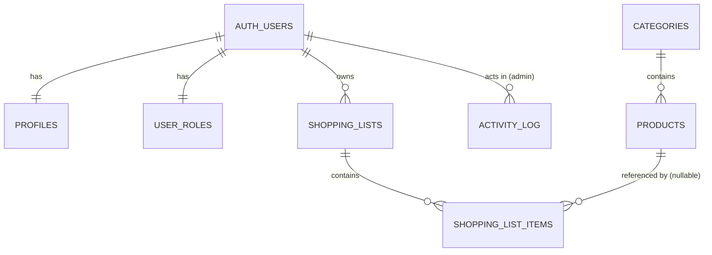

# Backend Schema (Supabase / PostgreSQL): SaudaList

Version 2.0 | Save the SQL in section 3 as `supabase/migrations/001_schema.sql` and run it in the Supabase SQL Editor.

## 1. Entity relationships



## 2. Design decisions

| Decision | Reason |
|---|---|
| Roles live in a separate `user_roles` table with no write policy | A user cannot promote themselves. A role column on an editable profile row would allow that |
| Units use one `unit_type` domain | One place to change the allowed units |
| List items keep `product_name` and `unit` snapshots, and `product_id` is nullable | Old lists stay readable after catalog changes, and custom items are supported |
| `products.category_id` uses `on delete restrict` | A category with products cannot be deleted. Deactivate it instead |
| `profiles.is_active` is enforced by RLS | Real deactivation, not just a UI check |
| Users can update only `full_name` on their own profile (column privilege) | They cannot re-activate themselves |
| Admin actions that cross users use `security definer` functions that check `is_admin()` | No service-role key is needed in the app |
| `image_path` stores the full Cloudinary `secure_url` | Images are not stored in the database |
| Prices are not in the MVP | Phase 2 adds nullable columns |

## 3. SQL (run once)

```sql
-- =====================================================================
-- SaudaList schema v2
-- =====================================================================

-- ---------- Types ----------
create type public.app_role as enum ('customer', 'admin');

create domain public.unit_type as text
  constraint unit_type_valid check (value in
    ('kg','g','litre','ml','pcs','dozen','packet','bottle','box','loaf','bunch','bag'));

-- ---------- Tables ----------
create table public.profiles (
  id uuid primary key references auth.users(id) on delete cascade,
  full_name text not null default '',
  email text,
  is_active boolean not null default true,
  created_at timestamptz not null default now(),
  updated_at timestamptz not null default now()
);

create table public.user_roles (
  user_id uuid primary key references auth.users(id) on delete cascade,
  role public.app_role not null default 'customer',
  created_at timestamptz not null default now()
);

create table public.categories (
  id uuid primary key default gen_random_uuid(),
  name text not null unique,
  image_path text,
  sort_order integer not null default 0,
  is_active boolean not null default true,
  created_at timestamptz not null default now(),
  updated_at timestamptz not null default now()
);

create table public.products (
  id uuid primary key default gen_random_uuid(),
  category_id uuid not null references public.categories(id) on delete restrict,
  name text not null,
  default_unit public.unit_type not null default 'pcs',
  image_path text,
  is_active boolean not null default true,
  created_at timestamptz not null default now(),
  updated_at timestamptz not null default now(),
  unique (category_id, name)
);

create table public.shopping_lists (
  id uuid primary key default gen_random_uuid(),
  user_id uuid not null references auth.users(id) on delete cascade,
  title text not null,
  created_at timestamptz not null default now(),
  updated_at timestamptz not null default now()
);

create table public.shopping_list_items (
  id uuid primary key default gen_random_uuid(),
  list_id uuid not null references public.shopping_lists(id) on delete cascade,
  product_id uuid references public.products(id) on delete set null,
  product_name text not null,
  quantity numeric(10,3) not null check (quantity > 0),
  unit public.unit_type not null,
  is_checked boolean not null default false,
  sort_order integer not null default 0,
  created_at timestamptz not null default now(),
  updated_at timestamptz not null default now(),
  unique (list_id, product_id)
);

create table public.activity_log (
  id uuid primary key default gen_random_uuid(),
  actor_id uuid references auth.users(id) on delete set null,
  title text not null,
  subtitle text not null default '',
  created_at timestamptz not null default now()
);

-- ---------- Indexes ----------
create index products_category_idx on public.products(category_id);
create index products_name_idx on public.products(lower(name));
create index lists_user_idx on public.shopping_lists(user_id);
create index items_list_idx on public.shopping_list_items(list_id);
create index activity_created_idx on public.activity_log(created_at desc);

-- ---------- Helper functions ----------
create or replace function public.set_updated_at()
returns trigger language plpgsql as $$
begin new.updated_at = now(); return new; end; $$;

create or replace function public.is_admin()
returns boolean language sql stable security definer set search_path = public as $$
  select exists (
    select 1 from public.user_roles
    where user_id = auth.uid() and role = 'admin'
  );
$$;

create or replace function public.is_active_user()
returns boolean language sql stable security definer set search_path = public as $$
  select coalesce(
    (select is_active from public.profiles where id = auth.uid()), false);
$$;

-- ---------- Triggers ----------
create trigger t_profiles_upd   before update on public.profiles
  for each row execute function public.set_updated_at();
create trigger t_categories_upd before update on public.categories
  for each row execute function public.set_updated_at();
create trigger t_products_upd   before update on public.products
  for each row execute function public.set_updated_at();
create trigger t_lists_upd      before update on public.shopping_lists
  for each row execute function public.set_updated_at();
create trigger t_items_upd      before update on public.shopping_list_items
  for each row execute function public.set_updated_at();

-- Create profile and customer role on signup
create or replace function public.handle_new_user()
returns trigger language plpgsql security definer set search_path = public as $$
begin
  insert into public.profiles (id, full_name, email)
  values (new.id, coalesce(new.raw_user_meta_data->>'full_name', ''), new.email);
  insert into public.user_roles (user_id, role) values (new.id, 'customer');
  return new;
end; $$;

create trigger on_auth_user_created
  after insert on auth.users
  for each row execute function public.handle_new_user();

-- Changing an item updates the parent list's updated_at (for "recent" sorting)
create or replace function public.touch_parent_list()
returns trigger language plpgsql security definer set search_path = public as $$
begin
  update public.shopping_lists
     set updated_at = now()
   where id = coalesce(new.list_id, old.list_id);
  return null;
end; $$;

create trigger t_items_touch_list
  after insert or update or delete on public.shopping_list_items
  for each row execute function public.touch_parent_list();

-- ---------- Admin functions (no service-role key needed) ----------
create or replace function public.admin_set_user_active(target uuid, active boolean)
returns void language plpgsql security definer set search_path = public as $$
begin
  if not public.is_admin() then raise exception 'not allowed'; end if;
  update public.profiles set is_active = active where id = target;
end; $$;

create or replace function public.admin_stats()
returns json language plpgsql stable security definer set search_path = public as $$
begin
  if not public.is_admin() then raise exception 'not allowed'; end if;
  return json_build_object(
    'users',      (select count(*) from public.profiles),
    'lists',      (select count(*) from public.shopping_lists),
    'products',   (select count(*) from public.products where is_active),
    'categories', (select count(*) from public.categories where is_active)
  );
end; $$;

revoke all on function public.admin_set_user_active(uuid, boolean) from public;
revoke all on function public.admin_stats() from public;
grant execute on function public.admin_set_user_active(uuid, boolean) to authenticated;
grant execute on function public.admin_stats() to authenticated;
grant execute on function public.is_admin() to authenticated;
grant execute on function public.is_active_user() to authenticated;

-- ---------- Column privileges: users may only edit their own full_name ----------
revoke update on public.profiles from authenticated;
grant update (full_name) on public.profiles to authenticated;

-- ---------- Row Level Security ----------
alter table public.profiles            enable row level security;
alter table public.user_roles          enable row level security;
alter table public.categories          enable row level security;
alter table public.products            enable row level security;
alter table public.shopping_lists      enable row level security;
alter table public.shopping_list_items enable row level security;
alter table public.activity_log        enable row level security;

-- profiles
create policy profiles_select_own on public.profiles
  for select to authenticated using (id = auth.uid());
create policy profiles_select_admin on public.profiles
  for select to authenticated using (public.is_admin());
create policy profiles_update_own on public.profiles
  for update to authenticated
  using (id = auth.uid()) with check (id = auth.uid());

-- user_roles (no insert, update, or delete policies: changes only in SQL Editor)
create policy roles_select_own on public.user_roles
  for select to authenticated using (user_id = auth.uid());
create policy roles_select_admin on public.user_roles
  for select to authenticated using (public.is_admin());

-- categories
create policy categories_read on public.categories
  for select to authenticated
  using ((is_active = true and public.is_active_user()) or public.is_admin());
create policy categories_admin_insert on public.categories
  for insert to authenticated with check (public.is_admin());
create policy categories_admin_update on public.categories
  for update to authenticated
  using (public.is_admin()) with check (public.is_admin());
create policy categories_admin_delete on public.categories
  for delete to authenticated using (public.is_admin());

-- products
create policy products_read on public.products
  for select to authenticated
  using ((is_active = true and public.is_active_user()) or public.is_admin());
create policy products_admin_insert on public.products
  for insert to authenticated with check (public.is_admin());
create policy products_admin_update on public.products
  for update to authenticated
  using (public.is_admin()) with check (public.is_admin());
create policy products_admin_delete on public.products
  for delete to authenticated using (public.is_admin());

-- shopping_lists (owner only, and only while the account is active)
create policy lists_own on public.shopping_lists
  for all to authenticated
  using (user_id = auth.uid() and public.is_active_user())
  with check (user_id = auth.uid() and public.is_active_user());

-- shopping_list_items (through the parent list's owner)
create policy items_own on public.shopping_list_items
  for all to authenticated
  using (
    public.is_active_user() and exists (
      select 1 from public.shopping_lists l
      where l.id = list_id and l.user_id = auth.uid()))
  with check (
    public.is_active_user() and exists (
      select 1 from public.shopping_lists l
      where l.id = list_id and l.user_id = auth.uid()));

-- activity_log (admin only)
create policy activity_admin_select on public.activity_log
  for select to authenticated using (public.is_admin());
create policy activity_admin_insert on public.activity_log
  for insert to authenticated
  with check (public.is_admin() and actor_id = auth.uid());

-- ---------- Seed: categories and starter products ----------
insert into public.categories (name, sort_order) values
  ('Fruits & Vegetables', 0),
  ('Dairy & Breakfast', 1),
  ('Munchies & Snacks', 2),
  ('Cold Drinks & Juices', 3),
  ('Instant & Frozen Food', 4),
  ('Tea, Coffee & Health Drinks', 5),
  ('Bakery & Biscuits', 6),
  ('Atta, Rice & Dal', 7)
on conflict (name) do nothing;

insert into public.products (category_id, name, default_unit)
select c.id, v.name, v.unit::public.unit_type
from (values
  ('Dairy & Breakfast',           'Fresh Organic Milk',     'litre'),
  ('Bakery & Biscuits',           'Whole Wheat Bread',      'loaf'),
  ('Fruits & Vegetables',         'Alphonso Mangoes',       'kg'),
  ('Fruits & Vegetables',         'Green Spinach',          'bunch'),
  ('Atta, Rice & Dal',            'Basmati Rice 5kg',       'bag'),
  ('Atta, Rice & Dal',            'Cold Pressed Olive Oil', 'ml'),
  ('Dairy & Breakfast',           'Eggs',                   'pcs'),
  ('Cold Drinks & Juices',        'Mango Juice',            'litre'),
  ('Munchies & Snacks',           'Namkeen Mix',            'packet'),
  ('Tea, Coffee & Health Drinks', 'Green Tea',              'box')
) as v(cat, name, unit)
join public.categories c on c.name = v.cat
on conflict (category_id, name) do nothing;
```

## 4. Create the first admin

1. Sign up in the app with your own email.
2. In the SQL Editor run:

```sql
update public.user_roles
   set role = 'admin'
 where user_id = (select id from auth.users where email = 'YOUR_EMAIL_HERE');
```

Roles are never changed from the app.

## 5. Changing the allowed units later

```sql
alter domain public.unit_type drop constraint unit_type_valid;
alter domain public.unit_type add constraint unit_type_valid check (value in
  ('kg','g','litre','ml','pcs','dozen','packet','bottle','box','loaf','bunch','bag','tray'));
```

Keep the app's unit list in sync with this domain.

## 6. How the app uses the schema

| Task | Call |
|---|---|
| Load catalog | `from('categories').select().eq('is_active', true).order('sort_order')`, `from('products').select().eq('is_active', true).order('name')` |
| My lists with items | `from('shopping_lists').select('*, items:shopping_list_items(*)').order('updated_at', ascending: false)` |
| Add item | `from('shopping_list_items').insert({list_id, product_id, product_name, quantity, unit})` |
| Duplicate product in a list | Unique `(list_id, product_id)` raises an error. Update the quantity instead |
| Load role | `from('user_roles').select('role').eq('user_id', uid)` |
| Admin statistics | `rpc('admin_stats')` |
| Activate or deactivate user | `rpc('admin_set_user_active', params: {'target': id, 'active': false})` |

RLS already limits the rows, so the user filter in queries is only an extra safeguard.

## 7. Verify security

Check that RLS is on:

```sql
select relname, relrowsecurity
from pg_class
where relnamespace = 'public'::regnamespace and relkind = 'r';
```

Every table should show `true`. List policies:

```sql
select tablename, policyname, cmd from pg_policies where schemaname = 'public' order by 1, 2;
```

Manual tests with two customer accounts and one admin account:

| Test | Expected |
|---|---|
| Customer A reads customer B's list id | Zero rows |
| Customer inserts or updates a product or category | Permission error |
| Customer updates their own `user_roles` | Permission error |
| Customer sets their own `is_active = true` | Permission error |
| Deactivated user reads products or lists | Zero rows |
| Admin inserts a product, customer reloads the catalog | Product appears |
| Admin deactivates a product | Hidden from the catalog, still named in old lists |
| Customer calls `admin_stats` | Error "not allowed" |

## 8. Phase 2 migrations (not in the MVP)

```sql
-- Optional prices. Null means "no price", so totals are skipped for that item.
alter table public.products            add column price numeric(10,2);
alter table public.shopping_list_items add column price_snapshot numeric(10,2);

-- Starter lists created by the admin (Monthly, Weekly, Party), copied into a user's own list
create table public.list_templates (
  id uuid primary key default gen_random_uuid(),
  title text not null,
  is_active boolean not null default true,
  created_at timestamptz not null default now()
);
create table public.list_template_items (
  id uuid primary key default gen_random_uuid(),
  template_id uuid not null references public.list_templates(id) on delete cascade,
  product_id uuid references public.products(id) on delete set null,
  product_name text not null,
  quantity numeric(10,3) not null check (quantity > 0),
  unit public.unit_type not null
);
-- Add RLS: authenticated users read active templates, only admins write.
```

## 9. Backups and limits

- The free plan is small. Text data for lists and products is tiny, images live in Cloudinary.
- Export `categories`, `products`, and `shopping_lists` to CSV from the Dashboard regularly.
- Free projects can pause when unused. The GitHub Actions keep-alive described in `TRD.md` prevents this.
