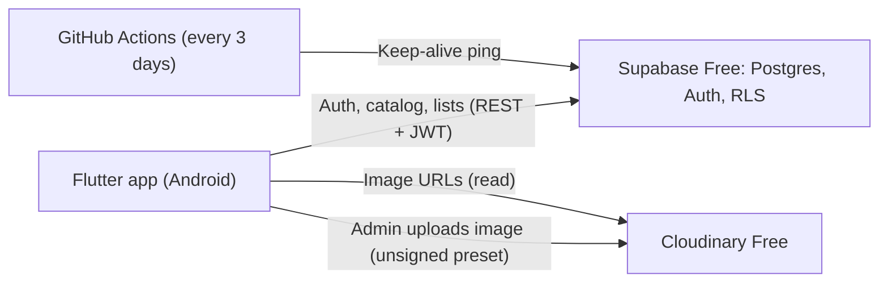

# Technical Requirements Document (TRD): SaudaList

Version 2.0 | Describes the target architecture. Current code status is in `Implementation_Plan.md`.

## 1. Architecture



There is no custom server. Supabase exposes the database as a secured REST API, and Row Level Security decides who can read or write each row. The Flutter app talks to it through `supabase_flutter`.

## 2. Technology stack

| Layer | Choice | Cost |
|---|---|---|
| Mobile app | Flutter 3.x, Dart 3.x, Material 3 with a neumorphic theme | Rs 0 |
| State | Provider (`ChangeNotifier`) | Rs 0 |
| Backend | Supabase Free (PostgreSQL, Auth, RLS) | Rs 0 |
| Images | Cloudinary Free | Rs 0 |
| PDF and print | `pdf`, `printing` | Rs 0 |
| Text share | `share_plus` | Rs 0 |
| Image pick and upload (admin) | `image_picker`, `http` | Rs 0 |
| Image cache | `cached_network_image` | Rs 0 |
| Source control, CI | GitHub, GitHub Actions | Rs 0 |
| Distribution | Signed APK on GitHub Releases | Rs 0 |

Not used: Firebase, Riverpod, go_router, Edge Functions, any paid service. Keep the existing navigation (`AppRoutes`) unless there is a clear reason to change it.

## 3. Project structure

```
lib/
  main.dart                 # init Supabase, then run app
  app.dart
  core/
    config/                 # env access (String.fromEnvironment)
    routing/                # AppRoutes, route guards
    theme/                  # neumorphic_theme, catalog_look, logo
    utils/                  # formatters, validators
  models/                   # Category, Product, ShoppingListModel, ShoppingListItem, AppUser
  services/
    supabase_service.dart   # client + initialize
    auth_service.dart       # sign up, sign in, sign out, reset password, load role
    category_service.dart
    product_service.dart
    shopping_list_service.dart
    cloudinary_service.dart # admin image upload
    pdf_service.dart
    share_service.dart      # PDF and text sharing
    admin_service.dart      # user list, set active, stats, activity log
  state/                    # AppState (split later: auth, catalog, lists)
  features/                 # auth, home, categories, products, saved_lists, pdf_preview, settings, admin
  shared/widgets/           # loading, empty, error, product card, buttons
supabase/migrations/
  001_schema.sql            # copy of the SQL in Backend_Schema.md
docs/
```

## 4. Configuration and secrets

- Supabase URL and anon key are passed at build time, not committed:

```bash
flutter run -d <device> \
  --dart-define=SUPABASE_URL=https://xxxx.supabase.co \
  --dart-define=SUPABASE_ANON_KEY=your_anon_key
```

- `main.dart` reads them with `String.fromEnvironment` and calls `Supabase.initialize` **before** `runApp`, then awaits `AppState.bootstrap()`.
- Cloudinary needs only the cloud name and an unsigned preset name (`CLOUDINARY_CLOUD`, `CLOUDINARY_PRESET`), also via `--dart-define`.
- Never in the app or in Git: the Supabase `service_role` key, the Cloudinary API secret, database password.
- The anon key is public by design. RLS is the real protection.

## 5. Authentication and roles

- Supabase Auth (email and password). The SDK stores and refreshes the session.
- A database trigger creates the `profiles` row and a `customer` row in `user_roles` on signup. The full name is passed in sign-up metadata (`data: {'full_name': ...}`).
- After login the app loads the profile and role (`user_roles`) and exposes `isAdmin` from the database value only. **No client-side rule may grant admin** (the demo rule that checks for "admin" in the email must be removed).
- Roles are changed only in the Supabase SQL Editor.
- If `profiles.is_active` is false, the app signs the user out, and RLS also blocks that user's reads and writes.

## 6. Data access rules

- Services contain all database calls. Widgets call `AppState` or services, never raw queries.
- Errors are not swallowed. Services throw, `AppState` catches, sets a user-readable `errorMessage`, and the UI shows it with a SnackBar or an error widget with a Retry button. No silent fallback to demo data.
- Writes update the UI optimistically only if a failure rolls the change back and shows a message.
- Catalog list calls are cached in `AppState` and refreshed on pull-to-refresh. Search input is debounced (about 300 ms).
- Admin statistics and user activation use database functions (`admin_stats`, `admin_set_user_active`) that verify the caller is an admin.

## 7. Security model

| Table | User | Admin |
|---|---|---|
| `profiles` | Read own row, update `full_name` only | Read all, activate or deactivate through a function |
| `user_roles` | Read own role | Read all. Changes only in SQL Editor |
| `categories`, `products` | Read active rows | Full read and write |
| `shopping_lists`, `shopping_list_items` | Full access to own rows (and only while active) | No access to other users' lists |
| `activity_log` | None | Read and insert |

Full SQL is in `Backend_Schema.md`. Policies must be tested with two customer accounts and one admin account before release. Hiding a button is never treated as security.

## 8. Images (Cloudinary)

Flow for an admin adding a product image:

1. `image_picker` selects a file. Compress to about 100 KB or less before upload.
2. `cloudinary_service.dart` posts a multipart request to `https://api.cloudinary.com/v1_1/<cloud>/image/upload` with `file` and `upload_preset`.
3. The response `secure_url` is saved in `products.image_path`.
4. Users display images with `cached_network_image`. Request a small version by inserting a transformation into the URL:

```dart
String thumb(String url) =>
    url.replaceFirst('/upload/', '/upload/f_auto,q_auto,w_300/');
```

5. Missing or failed images show a placeholder icon.

Preset settings: unsigned, folder `saudalist`, allowed formats jpg, png, webp, file size limit. If uploads must be locked down further, move to signed uploads later (requires a server).

## 9. PDF and sharing

- `PdfService` builds an A4 document from the current saved list: app name, list title, date, item number, product name, quantity, unit, purchased mark, page numbers.
- Use `pw.MultiPage` for automatic page breaks and wrapped text.
- Preview with `PdfPreview` from `printing`. Share with `Printing.sharePdf`. Print with `Printing.layoutPdf`.
- Text sharing builds a numbered plain-text list and sends it through `share_plus`. Check the `share_plus` version's current API on pub.dev.
- Urdu or other non-Latin names need an embedded TTF font (for example Noto Naskh Arabic) loaded in `PdfService`.
- Android file saving differs from iOS. Verify behavior on a physical Android device.

## 10. Free-tier operations

- **Keep-alive:** GitHub Actions workflow runs every 3 days and calls the Supabase REST endpoint with the anon key. An empty result is fine. Repository secrets: `SUPABASE_URL`, `SUPABASE_ANON_KEY`.

```yaml
name: keep-supabase-alive
on:
  schedule:
    - cron: '0 6 */3 * *'
  workflow_dispatch:
jobs:
  ping:
    runs-on: ubuntu-latest
    steps:
      - run: |
          curl -sf '${{ secrets.SUPABASE_URL }}/rest/v1/categories?select=id&limit=1' \
            -H 'apikey: ${{ secrets.SUPABASE_ANON_KEY }}' \
            -H 'Authorization: Bearer ${{ secrets.SUPABASE_ANON_KEY }}'
```

- **Backups:** export tables to CSV from the Supabase Dashboard now and then.
- **Usage checks:** review Supabase and Cloudinary usage dashboards monthly.

## 11. Testing

| Type | What |
|---|---|
| Unit | Model `fromJson` and `toJson`, quantity validation, text-share formatter |
| Widget | Login, product list states (loading, empty, error), list details |
| Security (manual) | Customer A cannot read or edit customer B's lists. Customer cannot write products or categories. Deactivated user is blocked. Admin can manage catalog |
| Integration (manual, physical Android) | Sign up, sign in, add items, edit, PDF preview, share, print, admin adds product with image |
| Static | `flutter analyze` clean, `dart format` |

## 12. Build and release

- Package name and `applicationId` stay as they are in the existing Android config. Do not change them casually.
- Release: `flutter build apk --release` with a signing key stored outside Git. Add the `INTERNET` permission in the main manifest.
- Publish the APK on GitHub Releases. Play Store and App Store are out of scope because they have fees.
- Before sharing widely: add a privacy note, make sure demo credentials and demo data are removed, and run the security tests.

## 13. Known risks

| Risk | Mitigation |
|---|---|
| Supabase free project pauses | Keep-alive workflow, monthly check |
| Free limits reached | Small images, monitor usage dashboards |
| Unsigned Cloudinary preset can be abused if the name leaks | Restrict formats and size in the preset, monitor uploads, move to signed uploads later |
| UI-only role checks | Database policies for every admin action, tested |
| Large single `AppState` becomes hard to maintain | Split into auth, catalog, and lists notifiers after the backend is connected |
